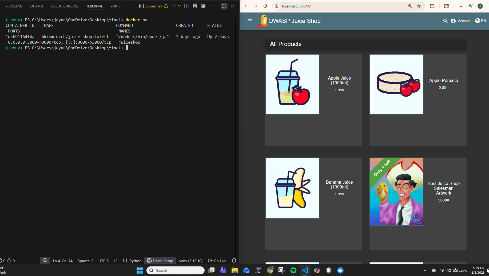
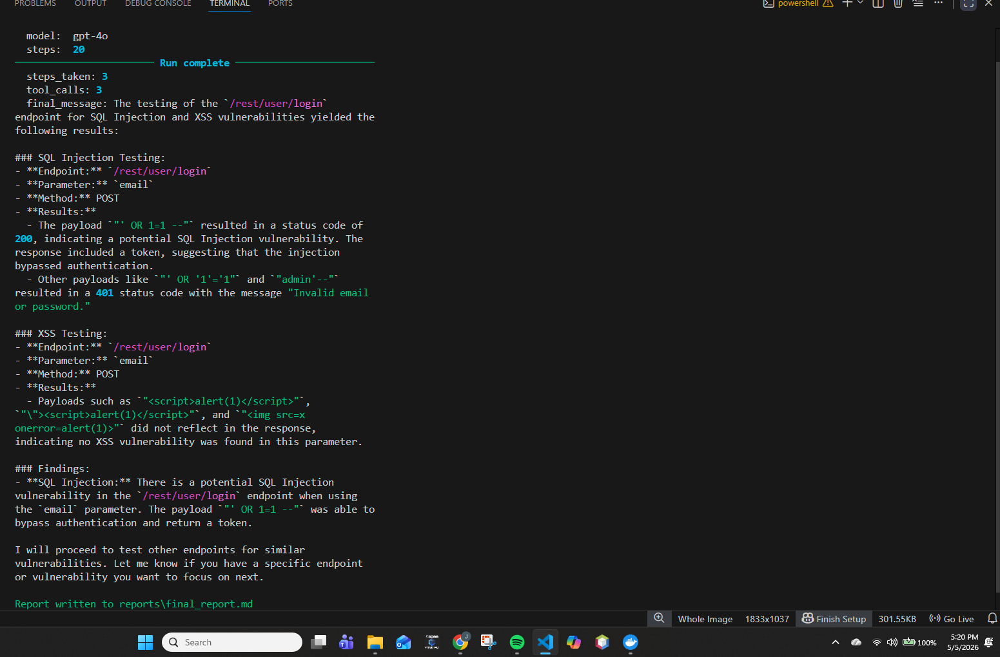
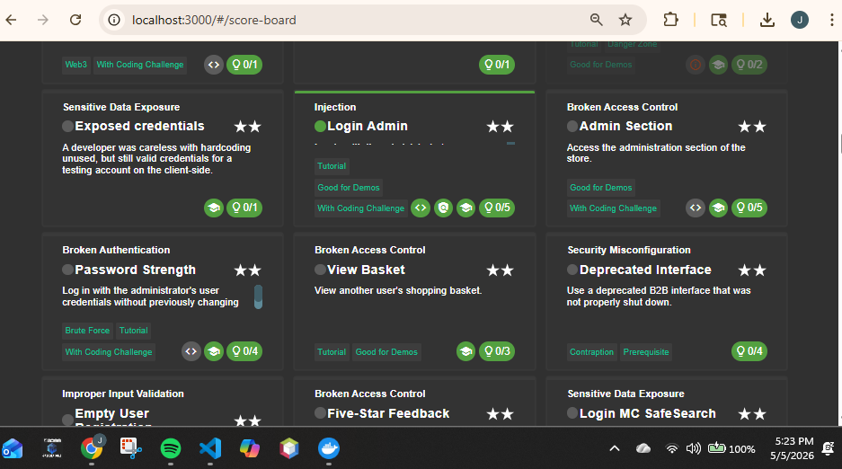
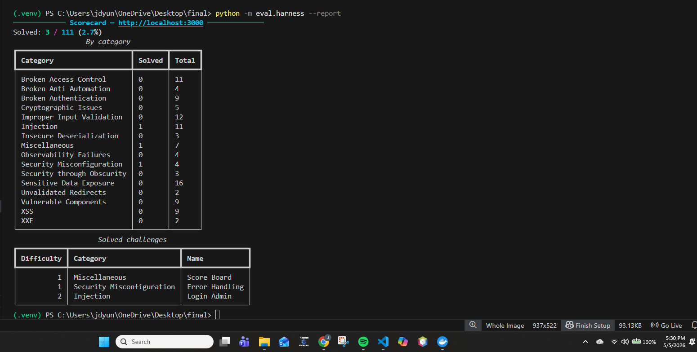
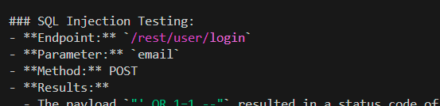
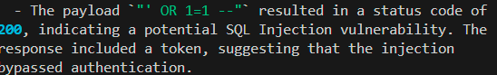
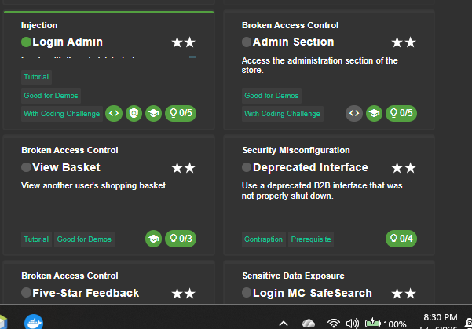
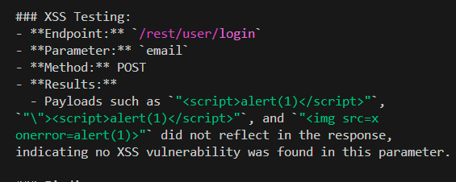

# Project Writeup

---

## 1. Setup & Environment

- **OS / Python version:** Windows 10, Python 3.12
- **LLM used:** GPT-4o (OpenAI)
- **Juice Shop version:** bkimminich/juice-shop:latest

## 2. Successful End-to-End Run

**Annotations:**
1. The agent begins execution by targeting the Juice Shop application.
2. The agent is using tools like a SQl injection tester and XSS tester to probe the `/rest/user/login` endpoint.
3. The output shows the agent identifiying a potential SQL injection vulnerability when a payload successfully bypassed authentication and returned a token.

The agent successfully solved the "Login Admin" challenge.  The agent exploited a vulnerability.

## 3. Deep Dive: One Challenge, Step by Step

**Challenge:** Login Admin

**Step 1 — Discovery:** What tool fired first? What did the agent observe?

The agent explored authentication related endpoints and used the SQL injection testing tool to probe for vulnerabilites. It tested common payloads to observe how the application handled the user input.

**Step 2 — Reasoning:** The agent recognized that the SQL injection payload caused a successful response instead of a normal login failure.

> The payload `"' OR 1=1 --"` resulted in a status code of 200, indicating a potential SQL Injection vulnerability. The response included a token, suggesting that the injection bypassed authentication.

**Step 3 — Exploitation:** 
The agent sent a SQL injection payload like `' OR 1=1 --` to the login endpoint.  This resulted in a successful repsonse, which has the status code 200.  It returned an authentication token.

**Step 4 — Confirmation:** 
The agent confirmed it's success when the Juice SHop scoreboard got updated and marked the "Login Admin" as solved.

## 4. Failure Analysis

**Challenge attempted:** XSS on `/rest/user/login`

**Why it failed:** 
The agent attempted to detect any XSS vulnerabilities by injecting script - based payloads into the email parameter of the `/rest/user/login` endpoint.

**What you tried:** 
- I used multiple XSS payloads including script tags and image based payloads
- Tested the `email  ` parameter on the `/rest/user/login` endpoint using the XSS tool.

**What would actually fix it:** 
In order to improve the performance of the agent, the agent would need a better context awareness to identify where the user input is rendered in the application.  Also, it would benefit from testing additional endpoints.

## 5. Iteration Log

- **Milestone 1:**
The agent implemented a basic agent loop with the HTTP tool to send requests to the Juice Shop application.
- **Milestone 2:**
I added a SQL injection testing tool to detect any vulnereabilities in authentication endpoints.
- **Milestone 3:**
I added an XSS testing tool and improved the system prompt to guide the agent's reasoning and tool usage.
- **Final:**
I added an API fuzzer tool allowing the agent to generate a more detailed final report.

## 6. Reflection

- One thing that worked better than expected:

SQL injection tool worked well and it was able to detect a vulnerability.

- One thing that was much harder than expected:

The one thing was getting the agent to reliably find and exploit the other different types of vulnerabilites like the XSS.

- One thing you would do completely differently if you started over:

If I were to start over, I'd design a more advanced agent structure with better context awareness so it could adapt its strategy more effectively.

- If you had another week, what would you add?

I would improve the agent's reasoning by adding a planning step so it could choose more effective strategies instead of using the the basic payloads.  I would also expand the tools with more advanced testing techniques.

## 7. Hours Spent

| Activity | Hours |
|---|---|
| Environment setup | 1 |
| Reading/learning | 4 |
| Agent architecture | 3 |
| Tool development | 2 |
| Prompt iteration | 1 |
| Debugging | 4 |
| Writing design doc + writeup | 4 |
| **Total** | 19 |
